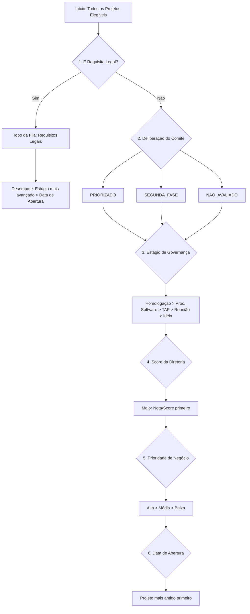

# ⚙️ Especificação Técnica Detalhada do Motor de Cálculo de Capacidade e Cronograma

O **Motor de Agendamento e Capacidade** do Sistema TIC é um algoritmo determinístico de alocação de capacidade finita (FCSC - *Finite Capacity Scheduling Calculation*) desenvolvido para governança de portfólio de TI.

Ele projeta automaticamente as datas de início e término de todos os projetos e fases da organização, classifica riscos de prazo (`ON_TIME`, `AT_RISK`, `DELAYED`), detecta impedimentos por falta de recursos e identifica sobrecargas de trabalho.

---

## 📐 1. Princípios Fundamentais e Arquitetura

O motor opera segundo cinco pilares essenciais:

1. **Capacidade Finita Realista**: Nenhum recurso pode trabalhar mais do que sua jornada líquida disponível em um único dia.
2. **Priorização Rígida de Fila**: Os projetos no topo da fila consomem a capacidade disponível dos recursos primeiro. Projetos de menor prioridade aguardam a liberação de agenda.
3. **Respeito ao Calendário Corporativo**: Finais de semana (sábados e domingos), feriados nacionais/globais e indisponibilidades individuais (férias, licenças) são zerados no cálculo de capacidade.
4. **Desconto de Progresso por Estágio**: Projetos em fases avançadas (ex: *Homologação*) já tiveram suas fases iniciais (*Gestão de Projetos*, *Levantamento*, *Arquitetura*) concluídas e necessitam apenas do esforço das fases restantes.
5. **Precedência Absoluta de Requisitos Legais**: Projetos marcados como **Requisito Legal** furam a fila de projetos normais, independentemente de notas da diretoria ou prioridades comerciais.

---

## 🧮 2. Fórmulas de Cálculo e Capacidade Líquida

### 2.1 Capacidade Diária Líquida por Recurso
Cada recurso possui uma carga horária semanal cadastrada ($H_s$), um percentual de reuniões/overhead ($O$) e um percentual dedicado a desenvolvimento de projetos ($D$).

$$\text{Horas Líquidas por Dia} = \frac{H_s \times (1 - O) \times D}{5}$$

$$\text{Capacidade Diária (Minutos)} = \text{Math.round}\left(\text{Horas Líquidas por Dia} \times 60\right)$$

#### Exemplo Prático de Capacidade:
- **Recurso**: Desenvolvedor Senior (Ana)
- **Horas Semanais ($H_s$)**: $44\text{h}$
- **Overhead ($O$)**: $15\%$ ($0,15$)
- **Foco Dev ($D$)**: $70\%$ ($0,70$)

$$\text{Horas Líquidas por Dia} = \frac{44 \times (1 - 0,15) \times 0,70}{5} = \frac{44 \times 0,85 \times 0,70}{5} = \frac{26,18}{5} = 5,236\text{ horas/dia}$$

$$\text{Capacidade Diária em Minutos} = 5,236 \times 60 = 314\text{ minutos/dia} \approx 5\text{h } 14\text{min por dia}$$

---

### 2.2 Desconto de Indisponibilidades e Feriados

Na data $D$, a capacidade efetiva do recurso $R$ é calculada da seguinte forma:

1. **Se $D$ for Sábado ou Domingo**: Capacidade = $0\text{ min}$.
2. **Se $D$ for Feriado Global ou Recorrente**: Capacidade = $0\text{ min}$.
3. **Se o Recurso $R$ possuir Indisponibilidade Individual em $D$**:
   - *Dia Completo* (Férias/Licença): Capacidade = $0\text{ min}$.
   - *Parcial* (Ex: Treinamento de 2h/dia): $\text{Capacidade do Dia} = \text{Capacidade Base} - \text{Minutos Indisponíveis}$.
4. **Capacidade Remanescente**: Desconta os minutos que já foram consumidos em $D$ por projetos com prioridade superior na fila.

---

## 🏆 3. Algoritmo de Ordenação da Fila de Prioridades (`sortFilaAutomatic`)

A fila de execução é gerada automaticamente aplicando a seguinte hierarquia rigorosa de desempate (critérios em ordem de execução):

### Regras Detalhadas da Ordenação:

1. **Requisito Legal (`isLegalRequirement = true`)**:
   - Fura a fila de todos os outros projetos.
   - Se houver múltiplos requisitos legais, desempata primeiro pelo **Estágio mais avançado** e depois pela **Data de Abertura mais antiga**.
2. **Deliberação do Comitê (`committeeDecision`)**:
   - `PRIORIZADO` (Ordem 1)
   - `SEGUNDA_FASE` (Ordem 2)
   - `NAO_AVALIADO` ou `null` (Ordem 3)
3. **Estágio de Governança (`status`)**:
   - `Homologação (6)` > `Processo de Software (5)` > `Análise TAP (4)` > `Agendar Reunião (2)` > `Ideia Registrada (1)`
4. **Score da Diretoria (`committeeScore`)**:
   - Ordenação decrescente (ex: nota $9.5$ vem antes de $8.0$).
5. **Prioridade de Negócio (`businessPriority`)**:
   - `Alta` > `Média` > `Baixa`.
6. **Data de Abertura (`openingDate`)**:
   - Ordem cronológica crescente (projetos abertos há mais tempo têm preferência).

---

## ⚡ 4. Modos de Execução das Fases

Cada fase do projeto é composta por uma ou mais alocações de recursos. O motor suporta dois modos de execução na fase:

### 4.1 Modo Simultâneo (`SIMULTANEOUS`)
Todas as alocações da fase iniciam **ao mesmo tempo** na data inicial da fase. 
- A data de término da fase será a data em que o recurso com a alocação mais longa concluir seu trabalho.

### 4.2 Modo Sequencial (`SEQUENTIAL`)
As alocações da fase são executadas **em esteira, uma após a outra**, respeitando a ordem cadastrada.
- O Recurso 2 só começa seu trabalho no dia em que o Recurso 1 finalizar suas horas alocadas.

---

## 🔄 5. Desconto de Progresso por Estágio de Governança (`getPhaseRemainingMinutes`)

Para evitar recalcular horas de fases que já foram concluídas no passado, o motor aplica regras de abatimento com base no status atual do projeto:

| Status Atual do Projeto | Fases Concluídas (0 min pendentes) | Fases Pendentes |
| :--- | :--- | :--- |
| **1 - Ideia Registrada** | Nenhuma | 100% de todas as fases |
| **2 - Agendar Reunião** | Gestão de Projetos (50% abatido) | Fases restantes 100% |
| **4 - Análise TAP** | Gestão de Projetos, Levantamento | Arquitetura, Dev, Testes, etc (100%) |
| **5 - Processo de Software** | Gestão, Levantamento, Arquitetura | Desenvolvimento, Testes, Homologação |
| **6 - Homologação** | Todas as fases anteriores | Homologação e Golive (100%) |

---

## 🚨 6. Classificação de Riscos e Impedimentos

Ao final do cálculo de cada projeto, o motor atribui um status de conformidade:

- 🟢 **`ON_TIME`**: O projeto será concluído dentro ou exatamente no prazo solicitado (`requestedDeadline`).
- 🟡 **`AT_RISK`**: O projeto será concluído no prazo, porém a margem de folga até o prazo final é menor ou igual à tolerância configurada (padrão: $\le 3$ dias).
- 🔴 **`DELAYED`**: A data final calculada pelo motor ultrapassa o prazo solicitado pelo cliente/solicitante.
- ⛔ **`IMPEDIDO`**: Acontece quando uma fase ativa do projeto **não possui nenhum recurso alocado**. O motor suspende o cálculo desse projeto e gera um alerta de inconsistência de governança.

---

## 🎬 7. Cenários Práticos Ilustrativos

### Cenário 1: Entrada de Requisito Legal com Fila Cheia
- **Situação**: O sistema possui 5 projetos comerciais na fila (todos com nota 10 do comitê). Chega um novo projeto **SD-999 (Adequação Bacen)** marcado como Requisito Legal.
- **Resultado do Motor**: O motor coloca o SD-999 no **posição 1 da fila**. A capacidade diária dos desenvolvedores é consumida prioritariamente pelo SD-999, empurrando as datas dos outros 5 projetos para a frente.

### Cenário 2: Impacto de Férias de um Recurso Chave
- **Situação**: O desenvolvedor Backend Carlos tem 314 min/dia. O projeto SD-100 requereu 628 min de dev (2 dias de trabalho). Carlos entra em férias de 10/08 a 20/08.
- **Resultado do Motor**: O motor agenda o 1º dia de trabalho em 09/08. Ao detectar a indisponibilidade em 10/08, ele pula todos os dias até 21/08 (primeiro dia útil após as férias) para alocar os 314 min restantes. A data final do projeto é calculada para 21/08.

### Cenário 3: Comparação de Impacto antes de Confirmar Alterações
- **Situação**: O gestor deseja alterar o parâmetro `eligibility_mode` de `only_prioritized` para `all_eligible`.
- **Resultado do Motor**: O motor roda uma **simulação em memória** sem alterar o banco de dados. Ele compara o hash de estado (`databaseStateHash`), calcula que 8 novos projetos entrarão na fila e reporta que o projeto SD-200 será postergado em 12 dias. O gestor pode revisar a lista exata antes de confirmar.
