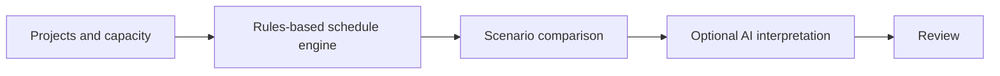

# AI-Assisted Project Planning

Capacity-aware project prioritization, scheduling and narrative analysis.

**Next.js, React, TypeScript, NestJS, Prisma, PostgreSQL, Redis, BullMQ, Groq**

## What it does

- Manages projects, resources, committee priorities and capacity allocations.
- A deterministic rules engine calculates schedules, bottlenecks and scenarios.
- AI interprets calculated results in a narrative; it does not calculate the schedule.
- Provides spreadsheet import/export and a separate read-only BI API.

## Workflow



## Local setup and use

Requires Node.js 20+, npm, PostgreSQL and Redis. Configure a local `.env` from `.env.example`.
```powershell
npm ci
npx prisma generate --schema packages/database/prisma/schema.prisma
npm run dev:api
# In separate terminals:
npm run dev:web
npm run dev:worker
```
Apply Prisma migrations only to a new isolated development database. `npm test` runs workspace tests; `npm run build` builds the workspaces.

## Configuration

Environment names declared by the included examples (values must be supplied locally):

`API_HOST_PORT`, `BI_API_KEY`, `CORS_ORIGINS`, `DATABASE_URL`, `GROQ_API_KEY`, `GROQ_MODEL`, `GROQ_TIMEOUT_MS`, `JWT_SECRET`, `NEXT_PUBLIC_API_URL`, `PORT`, `POSTGRES_HOST_PORT`, `POSTGRES_PASSWORD`, `REDIS_HOST_PORT`, `REDIS_URL`, `WEB_HOST_PORT`.

## Boundaries and limitations

The operational seed is deliberately absent; a new database requires safe first-user provisioning before interactive use. Root seed/studio aliases are not a complete bootstrap procedure. The worker processor is a placeholder; scheduling runs in the API. External AI calls are optional and were not exercised.

This is a source snapshot, not a claim of production readiness. Business results, dates and unmeasured performance are intentionally not asserted. Application UI language is preserved.

## License

No new distribution license is granted for this corporate source edition. Public visibility does not grant reuse rights; obtain permission from the relevant rights holder. Existing third-party notices remain applicable.

## Further reading

[Architecture and local operations](docs/ARCHITECTURE.md) explains service boundaries, bootstrap gaps and verification limits.

## Verification record

See [snapshot checks and remaining limitations](docs/VERIFICATION.md).
