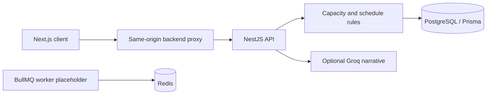

# Architecture and local operations

The application separates scheduling from AI interpretation. Project effort, priority, phases, dependencies and available capacity feed deterministic API calculations. The AI narrative consumes results; it cannot change the calculated schedule.

## Boundaries

- `apps/web`: screens and `/backend-api` proxy; web development uses port 3100.
- `apps/api`: sessions, project governance, spreadsheet operations, simulation and BI read endpoints.
- `packages/database/prisma`: schema and migrations. Generating Prisma code does not migrate a database.
- `apps/worker`: queue scaffolding. The placeholder processor is not the scheduling engine.
- `scripts`: maintenance/reconciliation utilities. Some write data; inspect the command and database target before use.

## Configuration and bootstrap

Configure `DATABASE_URL`, `REDIS_URL`, `JWT_SECRET` and `CORS_ORIGINS` for a new local environment. `INTERNAL_API_URL` controls the web proxy; `NEXT_PUBLIC_API_URL` is not the active client transport. `BI_API_KEY` protects `/bi/v1` reads via `X-API-Key`.

The Compose API startup applies migrations. It must point at an isolated development database. The operational seed was excluded and a new install does not contain a working administrator account. Implement a reviewed first-user provisioning procedure before attempting interactive use. Do not substitute operational seed files.

## Verification boundaries

Workspace unit tests and builds can run without the operational database. They do not verify login against a provisioned database, spreadsheet compatibility, corporate integrations or live AI provider access. Health endpoints are `/health` and `/ready`; Swagger is under `/docs` on the API.

No deployment is part of this source release. Git deployment is disabled in the web configuration.
